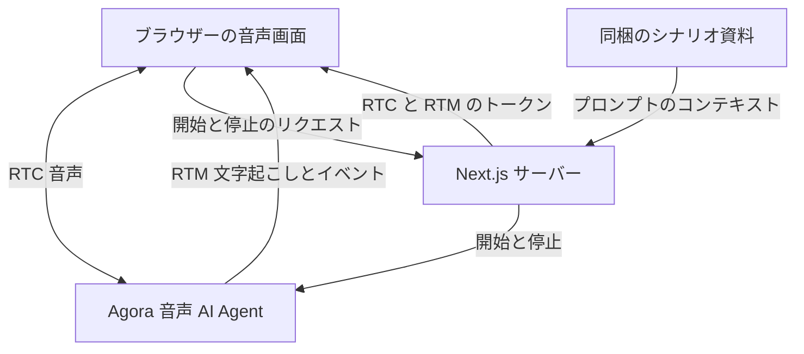

# Agora カスタマーサポートアシスタント デモ

[English](README.md) | [简体中文](README.zh-CN.md) | [日本語](README.ja.md)

Agora と Next.js で構築した音声 AI カスタマーサポートのデモです。製品やサービスについて相談し、基本的な問題を切り分け、販売店やサービス提供元への問い合わせ内容を整理できます。

**[Agora Recipes で音声 AI デモをもっと探す →](https://recipes.agora.io/)**

[](https://www.agora.io/en/products/conversational-ai-engine/)
[](https://nextjs.org/docs)
[](LICENSE)

[機能](#features) · [技術構成](#tech-stack) · [ローカル実行](#run-locally) · [Vercel へのデプロイ](#deploy-to-vercel) · [使い方](#how-it-works) · [カスタマイズ](#customize) · [よくある質問](#faq) · [関連リンク](#more)

<a id="what-you-can-do"></a>

<a id="features"></a>

## 機能

- **一般的な相談：** 製品の使い方、欠品、返品、配送、請求、アカウントの問題を相談できます。
- **段階的な切り分け：** 症状と実施済みの確認を伝え、安全な次の手順を相談できます。
- **追加質問と確認：** 会話中に問題を詳しく説明し、情報を訂正できます。
- **問い合わせの要約：** 問題、実施済みの確認、販売店への質問をまとめます。
- **音声と文字起こし：** 自然に話しながら会話をテキストでも確認できます。

<a id="tech-stack"></a>

## 技術構成

- **フロントエンド：**  Next.js、React、TypeScript。
- **音声 AI：**  Agora Conversational AI、Agents SDK、RTC、RTM。
- **モデル：**  Deepgram STT、OpenAI LLM、MiniMax TTS。

<a id="quick-start"></a>

<a id="run-it"></a>

<a id="try-it"></a>

<a id="conversation"></a>

## はじめに

<a id="run-locally"></a>

### ローカル実行

Node.js 24、pnpm 9.15.9、Conversational AI を有効にした [Agora プロジェクト](https://console.agora.io/)が必要です。

**1. インストールと設定**

このリポジトリをクローンまたはダウンロードし、そのディレクトリでターミナルを開きます。

```bash
pnpm install --frozen-lockfile

if [ ! -f .env.local ]; then
  cp env.local.example .env.local
fi
```

[Agora Console](https://console.agora.io/) でプロジェクトを作成または選択します。**Manage credentials** を開き、**App ID** と **Primary certificate** を `.env.local` にコピーします（[手順](https://docs.agora.io/en/introduction/console-setup)）。

```dotenv
NEXT_PUBLIC_AGORA_APP_ID=your_agora_app_id
NEXT_AGORA_APP_CERTIFICATE=your_agora_app_certificate
```

デフォルトの音声・言語モデルには別途 API キーは不要です。App Certificate はサーバー専用です。`.env.local` に保存し、ブラウザーのコードに公開しないでください。設定例は [env.local.example](env.local.example) を参照してください。

**2. アプリを起動**

```bash
pnpm run doctor
pnpm run dev
```

[http://localhost:3000](http://localhost:3000) を開き、**Start customer support** を選んでマイクの使用を許可します。必要に応じて要約を依頼し、終了ボタン（**End session**）で通話を終えます。

<a id="deployment"></a>

<a id="deploy-to-vercel"></a>

### Vercel へのデプロイ

[](https://vercel.com/new/clone?repository-url=https%3A%2F%2Fgithub.com%2FAgoraIO-Community%2Fagora-customer-support-assistant-demo&env=NEXT_PUBLIC_AGORA_APP_ID%2CNEXT_AGORA_APP_CERTIFICATE&envDescription=Agora%20App%20ID%20and%20App%20Certificate%20from%20Agora%20Console.%20Enable%20Conversational%20AI%20for%20the%20project.&envLink=https%3A%2F%2Fdocs.agora.io%2Fen%2Fintroduction%2Fconsole-setup&project-name=agora-customer-support-assistant-demo&repository-name=agora-customer-support-assistant-demo)

1. ボタンからリポジトリを自分の Git アカウントにクローンし、Vercel に取り込みます。
2. **Next.js** と Node.js 24 を選びます。
3. **Environment Variables** で `NEXT_PUBLIC_AGORA_APP_ID` と `NEXT_AGORA_APP_CERTIFICATE` を設定してデプロイします。

<a id="how-it-works"></a>

## 使い方

1. **会話を開始：**  **Start customer support** を選び、マイクの使用を許可します。
2. **問題を説明：** 製品やサービスの問題と、試した対処を伝えます。
3. **順番に確認：** 有用な確認事項や次の手順を一つずつ相談します。
4. **要約を取得：** 販売店やサポートへの問い合わせ用に要約を依頼します。

### アーキテクチャ



Next.js がブラウザー用トークンを発行し、Agora Agent の起動時にシナリオの指示を渡します。会話はプロンプトに基づき、実際の業務システムには接続していません。詳細は [ARCHITECTURE.md](ARCHITECTURE.md) を参照してください。

<a id="faq-and-limitations"></a>

<a id="faq"></a>

## よくある質問

### 試すにはヘルプデスクとの接続が必要ですか？

いいえ。Agora プロジェクトと同梱のサポートガイドで試せます。

### アシスタントには何を伝えればよいですか？

製品やサービス、問題、試した対処を伝えてください。返品や配送については、アカウント識別子ではなく関連する案内や規約を共有します。例：「ヘッドホンが接続できません。再起動は試しました。」

### なぜ販売店への確認が必要なのですか？

アシスタントは注文情報や販売店のマニュアル、規約にアクセスできません。提供された情報の説明と質問の整理はできますが、条件の確認や返金処理はできません。

### 音声セッションを開始できないのはなぜですか？

ブラウザーのマイク権限、入力機器、Agora App ID、App Certificate、Conversational AI の利用権限を確認します。localhost または HTTPS を使ってください。`pnpm run doctor` でローカル設定を確認し、画面のエラーに従って再試行します。

### 会話のコピーを保存できますか？

はい。Inspector で **Export session evidence** を選び、現在または直前の通話を JSON でダウンロードできます。次の通話やページ更新の前にエクスポートしてください。

<a id="customize"></a>

### 実際の業務に近づけるにはどうしますか？

[RAG](https://docs.agora.io/en/ai/build/custom-model-integration/custom-llm)、[ツール呼び出し](https://docs.agora.io/en/ai/build/tools/custom-tools)、[MCP](https://docs.agora.io/en/ai/build/tools/mcp-tools) で独自のナレッジベースや業務サービスに接続します。 ツールを追加する際は [Agent 設定](app/api/invite-agent/route.ts)で `advancedFeatures.enable_tools` を `true` にします。

### 自分の用途に合わせるにはどうしますか？

用途に合わせて Agent のプロンプト、業務ツール、インターフェースを変更します。

## ライセンスと出典

[MIT License](LICENSE) の下で公開しています。[第三者の権利表記](THIRD_PARTY_NOTICES.md)を保持してください。

<a id="more"></a>

## 関連リンク

- **[Recipes](https://recipes.agora.io/)：** Agora のデモや連携例を探せます。
- **[Docs](https://docs.agora.io/en/ai)：** 音声 Agent の構築と拡張を学べます。
- **[Console](https://console.agora.io/)：** プロジェクト、認証情報、使用量を管理します。
